# Testing Documentation

Owner: Sino

This document describes how the Digital Logbook is tested, what the automated test suites cover, the current test and coverage results, and the user feedback collected from the formal survey.

## Automated Testing

### What is tested

Together, `client/` and `server/` contain more than 90 test files.

**Backend (`server/`)**

- Computed field formula evaluation — valid formulas, missing fields, invalid syntax (`services/computedFieldService.test.js`)
- Due date logic — overdue detection, completion status (`services/dueDateService.test.js`)
- Saved filter matching — all supported operators, built-in and custom fields (`services/savedFilterService.test.js`)
- Project detail service logic, including project references (`services/projectDetailsService.test.js`, `services/projectDetailsService.projectReferences.test.js`)
- Entry validation rules, plus automation rule and recurring entry validation (`validation/entry.validation.test.js`, `validation/automationRule.validation.test.js`, `validation/recurringEntry.validation.test.js`)
- Profile picture uploads — valid image formats, and rejection of malformed, oversized, or disguised uploads (`tests/profilePictures.test.js`)
- Entry-to-entry links (`tests/projectDetailsLinks.test.js`)
- Project field editing — adding, renaming, removing, and archiving fields without breaking existing entries or computed formulas (`tests/projectFields.test.js`)
- Entry revision history — creation, listing, viewing, and restoring past entry versions (`services/projectDetailsService.revisions.test.js`)
- Safe entry editing, including editing entries after the project schema has changed (`tests/entryEditSafety.test.js`, `tests/entryEditSchemaEvolution.test.js`)
- Checklists and automatic duration (`tests/checklist.test.js`, `tests/automaticDuration.test.js`)
- Automation rules — service, controller, and PostgreSQL repository (`services/automationRuleService.test.js`, `tests/automationRuleController.test.js`, `tests/automationRules.test.js`, `tests/postgresAutomationRuleRepository.test.js`)
- Recurring entries (`services/recurringEntryService.test.js`, `tests/recurringEntries.test.js`)
- Project sharing and collaborator notifications, including email sending (`tests/projectSharing.test.js`, `services/collaboratorNotificationService.test.js`, `services/emailService.test.js`, `tests/notifications.test.js`)
- Statistics and custom statistics (`tests/statistics.test.js`, `tests/customStatistics.test.js`, `tests/stats.activity.test.js`, `tests/stats.compareProjects.test.js`, `tests/stats.coverage.test.js`)
- Dashboard summary (`tests/dashboard.test.js`)
- Logbook export and import (`services/logbookTransferService.test.js`, `tests/logbookTransfer.test.js`)
- Authentication, project routes and server setup (`tests/authController.test.js`, `tests/projectsRoutes.test.js`, `tests/server.test.js`)
- PostgreSQL project details repository (`services/postgresProjectDetailsRepository.test.js`)
- Demo data seeding (`tests/seedDemoData.test.js`)
- External APIs — Gemini AI Project Progress, Gemini Text-to-Speech, and YouTube search (`tests/aiProjectProgressService.test.js`, `tests/aiProjectTtsService.test.js`, `tests/youtubeSearchService.test.js`)

Running `npm test` from `server/` executes all of the above, combining Vitest and Node's native test runner in one command.

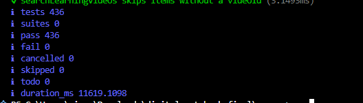

**Frontend (`client/`)**

- Entry creation, editing, details, archiving, and history (`EditEntryModal.test.jsx`, `NewEntryModal.test.jsx`, `EntryDetailsModal.test.jsx`, `EntryDetailsModalArchive.test.jsx`, `EntryHistoryModal.test.jsx`)
- Project details page behaviour, including reminders (`ProjectDetails.test.jsx`, `ProjectDetails.reminders.test.jsx`)
- Alternate entry views — calendar/board (`entryViews.test.js`, `CalendarView.test.jsx`, `BoardView.test.jsx`)
- Profile picture handling and the avatar creator (`profilePicture.test.js`, `avatarBuilder.test.js`, `AvatarCreator.test.jsx`)
- User settings and preferences (`Settings.test.jsx`, `preferences.test.js`)
- Offline support — online/offline detection and the offline entry queue (`useOnlineStatus.test.js`, `entryQueue.test.js`)
- Saved filters, automation rules, recurring entries, and project sharing interfaces (`SavedFilterModal.test.jsx`, `AutomationRulesModal.test.jsx`, `RecurringEntriesModal.test.jsx`, `SharingModal.test.jsx`)
- Notifications (`NotificationsBell.test.jsx`, `NotificationsPanel.test.jsx`, `useNotifications.test.js`)
- Dashboard, statistics, and charts (`Dashboard.test.jsx`, `Stats.test.jsx`, `CustomStatistics.test.jsx`, `charts.test.jsx`)
- Constellation page — scene, layout, graph model, selection panel, viewport, fallback, and data loading (`pages/Constellation/*.test.js` and `*.test.jsx`)
- AI Project Insight and Learning Videos (`AiProjectInsight.test.jsx`, `LearningVideos.test.jsx`)
- API helpers — entry features, dashboard, notifications, project sharing, recurring entries, AI project progress, and learning videos (`entryFeaturesApi.test.js`, `dashboardApi.test.js`, `notificationsApi.test.js`, `projectSharingApi.test.js`, `recurringEntriesApi.test.js`, `projectDetailsAiApi.test.js`, `learningVideosApi.test.js`)
- Application shell — sidebar, user context, and the main app (`Sidebar.test.jsx`, `UserContext.test.jsx`, `App.test.jsx`)

Running `npm test` from `client/` executes all of the above.

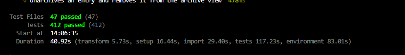

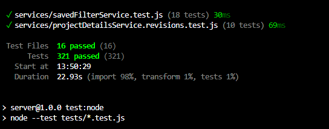

### Coverage and continuous integration

Both applications provide a `test:coverage` script (`npm run test:coverage` in `client/` and `server/`) that runs the tests and produces coverage reports using `@vitest/coverage-v8` and `c8`.

Each application is covered by two runners, so each produces two coverage reports: one from the Vitest suite and one from Node's native test runner. The reports below were generated on 11 October 2026. Coverage changes as tests are added, and Codecov holds the current per-file detail.

**Frontend (`client/`)**

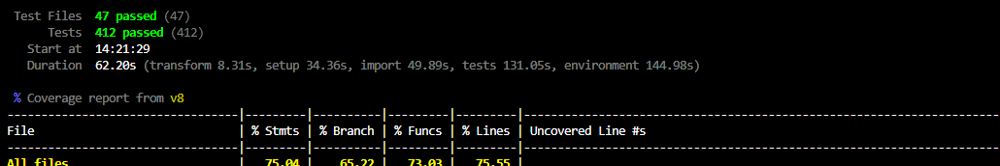

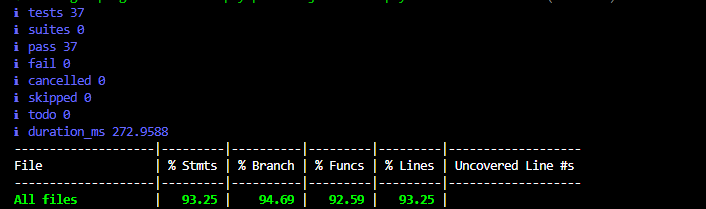

**Backend (`server/`)**

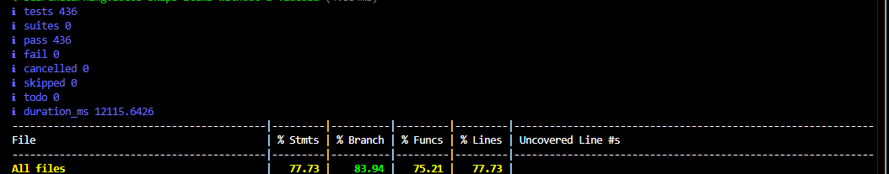

The `tests.yml` workflow runs both coverage scripts on every push to `main` and on every pull request, then uploads the reports to Codecov. See [codecov-setup.md](./codecov-setup.md) for the coverage setup and [tech-stack.md](./tech-stack.md) for the CI workflow.

### External API tests

The Gemini and YouTube integrations are tested with mocked providers, so the tests do not depend on live API access, credentials, or quota. They cover successful responses, malformed data, provider failures, and timeouts. See [External API Testing & Failure Handling](./external-api/testing.md) for details.

## User Feedback — Formal Process

The team collected formal user feedback through a structured Google Forms survey, run by Simphiwe. The survey received 9 responses, primarily university students (77.8% currently studying, mostly 3rd years), and covered onboarding, core feature usability, and overall satisfaction.

### Key findings

**Onboarding and core flows**

- 100% of respondents signed in successfully.
- 100% of respondents created a project without needing help; ease of project creation was rated highly (55.6% gave 5/5).
- 88.9% successfully created a logbook entry; one respondent (11.1%) did not.

**Usability**

- Navigation ease was rated highly: 55.6% gave the maximum score (5/5), with the remaining respondents rating it 4/5 or below.
- Most respondents reported nothing confusing about the app. Where confusion was reported, it centred on: entry/field creation, understanding the dashboard's logged-hours display, initial orientation, and sidebar navigation.
- Most respondents confirmed all buttons and labels were understandable; one respondent indicated otherwise without specifying further.

**Overall satisfaction**

- Average overall rating: 4.33 out of 5, with 55.6% of respondents giving the top score and no respondent rating the app below 3/5.

### Suggested improvements and how they were addressed

| Feedback received | Status |
|---|---|
| "The application should have stats... also a Calendar view" | ✅ Addressed — statistics (US-107) and calendar/board views (US-109/US-110) were implemented. |
| "tags on entries and able to update a filter" | ✅ Addressed — entry tags were added (offline-sync-tags feature), and saved filters can now be edited after creation. |
| "Maybe users should be given the ability to update their entries, even being able to delete them as well" | ✅ Addressed — entries can now be updated (`EditEntryModal`), and entry management functionality has been improved. |
| "to make it in a way that will guide you as you go" | ✅ Addressed — guidance features have been added to help users navigate through the system. |
| "down thoughts as you go" (in-the-moment note capture) | ✅ Addressed — users are able to capture and manage their thoughts within the application. |
| "Efficiency" | ✅ Addressed — improvements have been made to enhance usability and overall workflow efficiency. |
| "AI chatbot to help navigate the system" | ✅ Addressed — an alternative AI help system was implemented through a Help Suggestions button, where users can select a help topic and receive relevant answers directly. |
| "The application works really well, it doesn't need improvement" / "Nothing, I think the app is good" | — No action needed. |

### Process going forward

All feedback items have been addressed, with implemented improvements tracked against the original feedback collected. Future rounds of feedback collection will continue using the same structured survey format, allowing comparison against this baseline and helping the team identify further opportunities for improvement.

### Raw survey responses

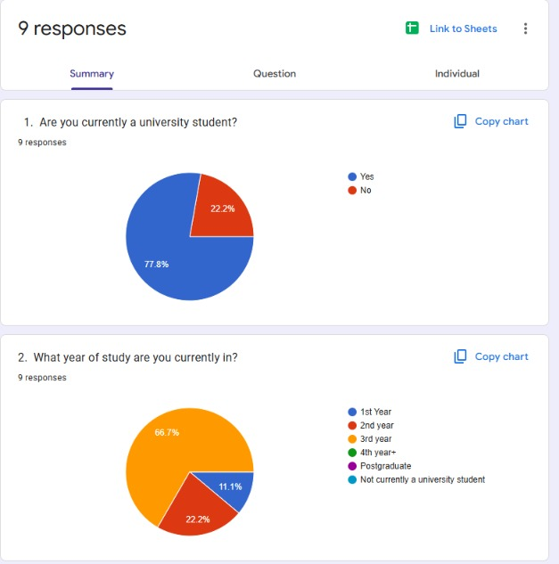

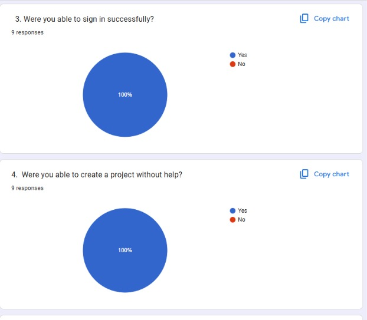

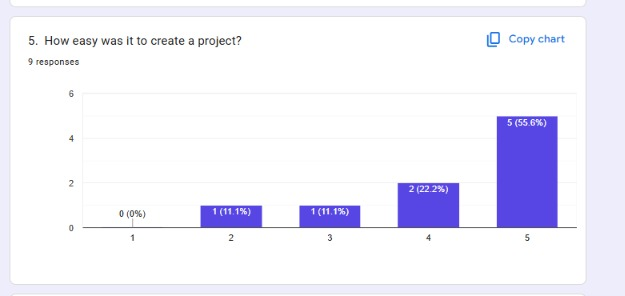

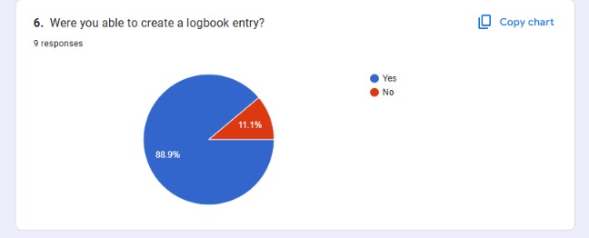

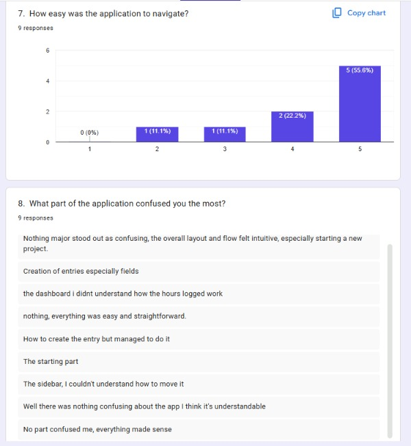

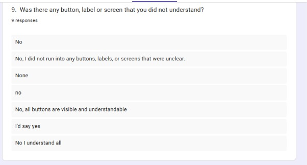

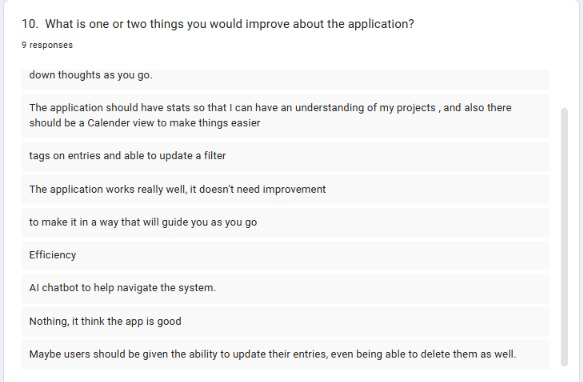

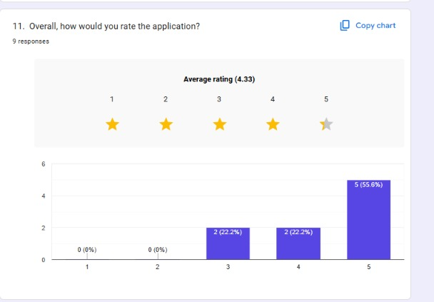
